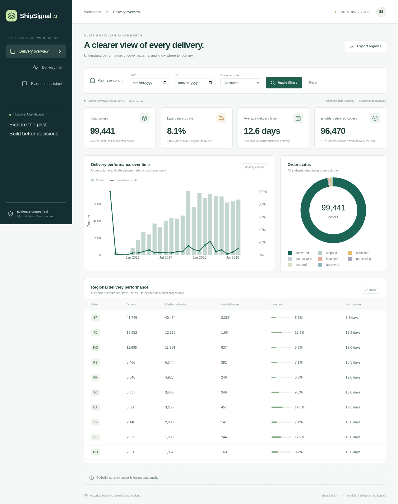

# ShipSignal AI

Historical e-commerce intelligence built on the real Olist Brazilian E-Commerce dataset: verified SQL analytics, chronological late-delivery modeling, multilingual review retrieval, and a cited evidence assistant.

**Status:** local application implemented and tested. Live OpenAI evidence selection requires a private API key and has not been verified in this environment. No external deployment has been performed. The models have weak held-out performance and are explicitly experimental. See [PROGRESS.md](PROGRESS.md) for exact checks, failures, fixes and remaining blockers.



## Features

- **Analytics:** historical order volume, late-delivery rate with explicit denominator, average/median delivery duration, monthly cohorts, regional performance, date/state filters and CSV regional export. SQL preaggregates child tables before joins and preserves order grain.
- **Delivery risk:** Logistic Regression baseline and CPU XGBoost, training-only preprocessing, chronological calibration/selection/test periods, label-maturity checks, saved artifacts and held-out prediction explorer. Actual metrics and calibration are inspectable; weak results are not hidden.
- **Evidence assistant:** English/Portuguese review search over local multilingual vectors, exact source records, and clearly labeled simulated guidance. Approved SQL and saved predictions supply all numerical claims. OpenAI optionally selects evidence IDs; server rendering validates citations and retains numerical authority. Missing-key mode is visibly evidence-only.
- **Data lineage:** original-byte archive, dataset snapshots, strict CSV discovery, quality profiles, PostgreSQL reconciliation and documented exceptions.

## Measured results

Real snapshot: `dbfbd3a2636389441845929bdfebcf282074943cd8b5db47d9fe5f3de9f87815`.

| Result | Measured value |
|---|---:|
| Historical orders | 99,441 |
| Eligible delivered orders | 96,470 |
| Late deliveries | 7,826 |
| Late-delivery rate | 8.1124% |
| Average purchase-to-delivery duration | 12.5582 days |
| Raw validation | 56/57 passed; known translation exception |

Delivery metrics include delivered orders with present actual/promise timestamps and nonnegative purchase-relative durations. Lateness is actual timestamp > estimated timestamp; timestamps remain naive. All statuses remain in order volume. Source coverage is 2016-09-04 through 2018-10-17 by purchase date, not live activity.

| Final test model | Precision | Recall | F1 | ROC-AUC | PR-AUC / AP | Brier |
|---|---:|---:|---:|---:|---:|---:|
| Logistic Regression | 0.053366 | 0.150295 | 0.078764 | 0.577262 | 0.062732 | 0.056153 |
| XGBoost — validation selected | 0.061947 | 0.006876 | 0.012378 | 0.566558 | 0.060734 | 0.052132 |

Test cohort: **19,279 observed delivered orders**, late prevalence **5.2804%**. XGBoost stays selected by validation AP, despite slightly higher Logistic Regression test AP; test data is not used to change the choice. Both models are **not validated for operational decisions**. See [measured evaluation and limitations](docs/evaluation.md).

Retrieval indexes **42,687 nonblank real review records**, **42,693 review chunks** and **5 simulated guidance documents**. A small, development-only diagnostic set measured **12/14 target-source hits@5**, MRR@5 **0.702381**, and **2/2 unsupported retrieval abstentions**. API checks verified **17/17 retrieved records** against original text/identifiers/hashes. These are diagnostic/source-integrity results, not general RAG or live-LLM answer accuracy. Live OpenAI generation was not evaluated without a key.

## Run locally

Clone the existing repository first (do not clone over an existing working folder):

```bash
git clone https://github.com/sahithiakunoor/ShipSignal-AI.git
cd ShipSignal-AI
```

If you already cloned it, run `git status` first. Preserve local edits and ignored `.env`/data/artifacts, then use `git pull --ff-only` on `main`; do not use a hard reset to update.

Prerequisites: Python 3.11+ (verified here on 3.12), Node 22.12+ (or supported newer Node), and Docker with Compose. Run from project root. Preserve any existing `.env`, source files, and PostgreSQL volume; skip initialization/download steps when already completed.

```bash
python -m venv .venv
source .venv/bin/activate
python -m pip install -c requirements-runtime.lock.txt -e '.[dev]'

# Fresh setup only: generates a private ignored file; refuses to overwrite an existing .env.
python scripts/init_local_env.py
docker compose up -d --wait

# Fresh source folder only: downloads the actual official public archive.
python scripts/download_olist.py
python scripts/run_local.py shipsignal inspect --source data/raw --source-url https://www.kaggle.com/datasets/olistbr/brazilian-ecommerce
python scripts/run_local.py shipsignal ingest
python scripts/run_local.py shipsignal validate
```

For this snapshot, validation intentionally returns exit status **1** for [DQ-001](docs/data_quality_exceptions.md): 13 products in two nonblank categories lack supplied translations; 610 missing categories are permitted. Do not replace a failed check with invented data. Other failures must be investigated. The following analytics job accepts only this reviewed exception and requires database reconciliation to pass.

```bash
python scripts/run_local.py python -m shipsignal.tasks analytics
python scripts/run_local.py python -m shipsignal.tasks train
python scripts/run_local.py python -m shipsignal.tasks index
python scripts/run_local.py python -m shipsignal.tasks evaluate-rag

npm --prefix frontend ci
npm --prefix frontend run build
python scripts/run_local.py uvicorn shipsignal.api.main:app --host 127.0.0.1 --port 8787
```

Open **http://localhost:8787**. API documentation: **http://localhost:8787/docs**. Keep the server running. The first indexing job downloads the quantized encoder and can take several minutes on CPU; subsequent interrupted builds resume verified chunks. Artifacts are generated locally, not fabricated or committed. A Transformers warning about no PyTorch backend is harmless here: only its tokenizer is used; ONNX Runtime performs encoder inference.

For React development, run the API command above and `npm --prefix frontend run dev` in another terminal, then open http://localhost:5173. Vite proxies /api to port 8787.

## Optional live OpenAI selection

Edit **only your ignored local `.env`** and add your own `OPENAI_API_KEY` and desired `LLM_MODEL` (default `gpt-4.1-mini`). Do not paste keys into chat, commit them, add them to VITE_* variables, or put values in `.env.example`. Restart the API after changing server environment configuration.

The live adapter returns only source IDs and abstention, not unrestricted prose or business numbers. It validates those IDs before rendering exact evidence and simulated actions. This is a deliberate grounding tradeoff. Without a key, SQL, saved risk estimates and retrieval remain useful, but the UI explicitly identifies them as evidence-only results.

## Test and verify

```bash
ruff check src tests scripts
ruff format --check src tests scripts
python scripts/test_backend.py
# Requires a dedicated local PostgreSQL role with CREATEDB for temporary test databases.
python scripts/test_backend.py --integration
npm --prefix frontend test

# With the application running and real artifacts ready:
python scripts/verify_analytics.py
python scripts/verify_ml.py
python scripts/verify_rag.py

# Browser checks; installs a browser if needed on your own computer.
cd frontend
npx playwright install chromium
E2E_BASE_URL=http://127.0.0.1:8787 npx playwright test --workers=1
```

On a machine with system Chromium, set `CHROMIUM_PATH` to its executable instead of downloading a second browser. Current software-test counts and browser outcomes are recorded in PROGRESS.md. Synthetic fixtures test code behavior; they are not business records or model-performance evidence. `requirements-dev.lock.txt` records the tested environment's package versions; `pyproject.toml` is the cross-platform installation source, including CPU-only XGBoost on Linux and ordinary XGBoost on macOS.

## Demonstration

1. Open **Delivery overview**. Point to historical coverage, snapshot identity and the 99,441-order total. Expand definitions to inspect the denominator and known exception.
2. Filter customer state to SP. Confirm cards, charts and regional rows change together. Export the regional CSV, then reset.
3. Open **Delivery risk**. Compare both measured test models and the prevalence baseline. Explain why the selected model remains experimental. Inspect the calibration plot and chronological split audit.
4. Select a held-out order and click **Recompute from approval-time features**. Verify it matches the saved prediction and inspect the exact feature allowlist. Later observed delivery outcomes were excluded from inputs.
5. Open **Evidence assistant**. Ask “What is the late delivery rate?” Inspect the executed tool result and SQL citation.
6. Ask “A entrega está atrasada e sem previsão de quando vai chegar” or “The chair arrived on time but was broken underneath.” Inspect original Portuguese records and source identifiers.
7. Ask what support should do for a broken item. Show the **SIMULATED GUIDANCE** label and cited authored action; do not present it as an Olist policy.
8. Ask “Where is my package right now?” Show explicit unsupported-scope abstention.
9. If a private OpenAI key is configured and verified, repeat the assistant queries and inspect the live provider status. Otherwise demonstrate evidence-only mode honestly.

## Structure and documentation

```text
src/shipsignal/       existing ingestion/profile/validation + analytics, ML, retrieval, assistant, API
src/shipsignal_data/  labeled simulated guidance and small retrieval diagnostic cases
frontend/            React, Plotly, CSS, unit and browser tests
scripts/             private environment helper, explicit download, verification and test commands
tests/               synthetic behavior tests + isolated PostgreSQL integration tests
docs/                model/data contracts, measured evaluation, screenshots and deployment preparation
PROGRESS.md          implemented / verified / incomplete / blocked outcomes
```

- [Architecture and operating boundaries](docs/architecture.md)
- [Feature availability and temporal evaluation](docs/feature_availability.md)
- [Actual evaluation results](docs/evaluation.md)
- [Observed source dictionary](docs/observed_source_dictionary.md)
- [Data grain and relationships](docs/data_model.md)
- [Known quality exception](docs/data_quality_exceptions.md)
- [Detailed source setup](docs/setup.md)
- [Deployment preparation and limitations](docs/deployment.md)

## Boundaries

This is historical analysis, not real-time logistics. No model impact, causal explanation, live generation score or deployment is invented. The app currently has no multi-user authentication/request quotas: use locally or behind an authenticated private gateway. PostgreSQL, model artifacts and Chroma need persistent storage for an external deployment. Read the deployment prerequisites before exposing LLM-backed endpoints publicly.

Raw CSVs, populated environments, models, prediction CSVs, full review corpus, dependency caches and private work are ignored. Public project documentation and reviewed evaluation metadata are separate from personal study material. GitHub publication requires explicit owner approval. The owner authorized publishing the working implementation in the current delivery request.


## Troubleshooting local setup

| Symptom | Action |
|---|---|
| `docker` unavailable or daemon not running | Install/start Docker Desktop and wait until its engine is ready. Run `docker compose version`. |
| Port 5433 or 8787 already in use | Check `lsof -i :5433` / `lsof -i :8787`. Stop only your own conflicting service, or consistently change the host port and private DATABASE_URL. |
| PostgreSQL authentication fails after changing `.env` | An existing volume retains its original database password. Restore the matching private credentials or follow the rotation instructions in `docs/setup.md`. Do not delete the volume. |
| Existing `.env` prevents initialization | Expected: the helper refuses to overwrite secrets. Keep the existing file. `.env.example` lists names and blank credential fields; it is not a runnable credential file. |
| `shipsignal` or Python package not found | Activate `.venv` and rerun the editable installation from project root. On macOS, install Apple's Command Line Tools if a dependency needs compilation. |
| XGBoost reports missing `libomp.dylib` on macOS | Install Homebrew's `libomp` (`brew install libomp`), then retry with your native-architecture Python environment. |
| Dataset download blocked | Download the official Olist archive manually from the Kaggle URL above and extract its nine CSV files directly into `data/raw/`. See `docs/setup.md`. |
| Validation reports 56/57 | Only the exact documented DQ-001 category-translation exception is expected for this snapshot. Investigate any other failure. |
| Analytics/models/retrieval report unavailable | Run the batch commands in order: ingest, analytics, train, index. Keep generated artifacts on the same machine/path as the server. |
| Model download/indexing interrupted | Check network and free disk space, then rerun `shipsignal.tasks index`; verified chunks resume. Initial model downloads require internet. |
| Assistant says evidence-only / not configured | Expected without an OpenAI API key. Analytics, historical predictions and local multilingual retrieval still work. No key is required for this demo mode. |
| React page blank or stale | Run `npm ci` and `npm run build` in `frontend`, restart the API and hard-refresh the browser. Inspect `/api/health` and `/docs`. |
| Playwright cannot find Chromium | In `frontend`, run `npx playwright install chromium`, or set `CHROMIUM_PATH` to an installed Chromium executable. |

For a Mac with Homebrew, missing prerequisites can be installed with `brew install python@3.12 node libomp` and `brew install --cask docker`. Start Docker Desktop before Compose. Use `python3.12 -m venv .venv` if `python` is unavailable before environment activation. No OpenAI key is needed for the verified evidence-only workflows.
