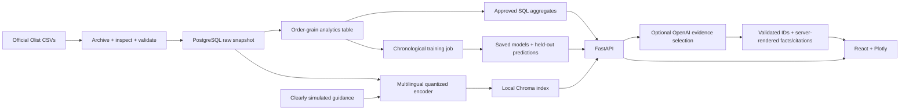

# Application architecture and operating boundaries

ShipSignal AI is a historical decision-support application built around one FastAPI process, one React frontend, PostgreSQL, saved scikit-learn/XGBoost pipelines, and a local Chroma index. Batch jobs are explicit and reproducible; no distributed worker or agent framework is required.

## Data grain and numerical authority

The raw snapshot is source-shaped and preserved. A derivative order_fact table is built only after reconciliation passes. Items and payments are aggregated to order_id before joins; customers are checked for parent uniqueness. The derivative has a primary key and count reconciliation. Reviews are not joined into order metrics. The dashboard and assistant both call the same approved analytics function; the assistant cannot write SQL or change tables.

Purchase-date filters are inclusive calendar dates, implemented as start <= timestamp < end + one day. Regional performance uses customer state. All order statuses count toward order volume. Delivery statistics require delivered status, present actual and estimated timestamps, and nonnegative purchase-relative actual/promise durations. Lateness compares actual timestamp to estimated timestamp, without timezone conversion or reinterpretation as end-of-day. All definitions and exclusions appear in the UI.

## ML boundaries

Prediction time is approval. Only the explicit feature allowlist reaches the model. There are no outcome-derived seller statistics, review features, final-status features, or timestamp-free payment aggregates. Catalog/seller attributes are treated as static because the export is not event-versioned; perfect historical catalog reconstruction is not claimed. The delivery promise is excluded as an input. Actual/promise timestamps and final status are used solely for target/cohort construction.

Chronological validation is subdivided into calibration and selection periods. Outcome-unavailable records are purged at each decision cutoff. Both fixed-parameter models are scored after model/threshold choices are frozen. Weak held-out performance is displayed honestly: no production readiness or causal drivers are claimed. The UI explores saved test-cohort predictions and can recompute a selected held-out order from its approval-time feature snapshot using the trusted saved pipeline. It does not monitor live shipments or score unrestricted arbitrary orders.

## Retrieval and generation boundaries

The encoder is a quantized ONNX export of `sentence-transformers/paraphrase-multilingual-MiniLM-L12-v2`, using masked mean pooling, normalized vectors, and a recorded immutable model revision. This retains multilingual retrieval while avoiding a large PyTorch/GPU runtime. It is not assumed numerically identical to the original encoder; actual retrieval diagnostics measure this implementation. Model assets download on initial setup, then are cached locally.

Review chunks preserve exact original character substrings using tokenizer offsets. Each has source-record number, review ID, order ID, chunk index, snapshot and content hash. Duplicate source review IDs remain separate records. Blank text is excluded from indexing, not deleted from structured source. Chunk size is 96 tokens with 16-token overlap; encoder maximum is 128 tokens. Five bundled guidance documents are authored examples labeled SIMULATED and never presented as real Olist policies.

Chroma query filters constrain actual review evidence by customer state and purchase cohort. Guidance remains unfiltered by historical cohort. Cosine distance is a similarity measure, not answer confidence. The review cutoff is fixed and may abstain on weak matches. Simulated guidance embeds its title and authored action; when conservative vector matching finds nothing, an explicit English/Portuguese topic lookup selects matching guidance IDs. This fallback is labeled and has no fabricated cosine score. Retrieval diagnostics assess this hybrid pipeline, not only encoder quality. Index builds are resumable under a local file lock; interrupted builds do not publish a new index manifest. Changing a chunking rule requires a new version rather than silently reusing different chunks.

OpenAI is optional but required for live LLM evidence selection. Its structured output contains only retrieved review IDs, simulated-guidance IDs and an abstention flag. IDs are validated for membership, type, uniqueness and limits. The server renders exact cited excerpts, authored simulated actions and verified numerical tool results. This deliberately narrower interface prevents the model from manufacturing business numbers; it sacrifices unrestricted prose generation. Retrieval text is untrusted data, and the LLM has no database or execution tools.

Without a key, evidence-only mode is explicit. Provider failures or invalid generated citations cause abstention or verified-facts-only rendering, never a fake successful LLM response. Mock tests establish application contracts; they do not establish live OpenAI answer quality.

## Operation and tradeoffs

- FastAPI remains modular Python inside the existing package. Each batch job is an explicit task; ingestion CLI remains compatible.
- Vite proxies /api in development. A production frontend build is served from FastAPI at the same origin. No LLM secret is embedded in browser configuration.
- PostgreSQL numeric and Python Decimal are used for money; model probabilities are floating-point estimates, not monetary facts.
- Model and index artifacts carry dataset identity. Stale snapshot artifacts are rejected. Model joblib files are trusted local outputs; do not load untrusted third-party pickles.
- Local exact profiling and embeddings are appropriate at this scale; memory/storage grow with cardinality. Model/index assets need persistent disk. No automatic refresh, multi-tenancy or production authentication is claimed.
- Live deployment needs a chosen platform, persistent database/artifact storage, TLS, authentication and secret configuration. No deployment is performed without those prerequisites.
